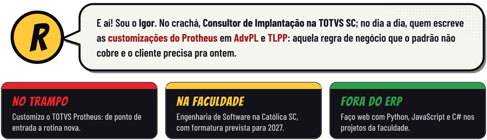
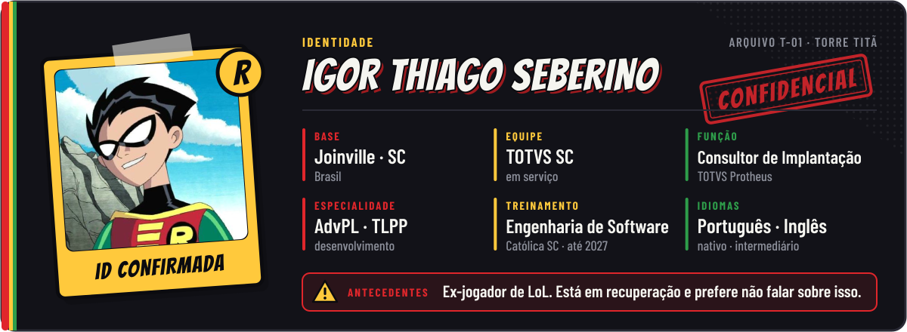
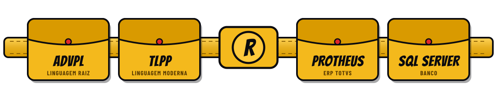
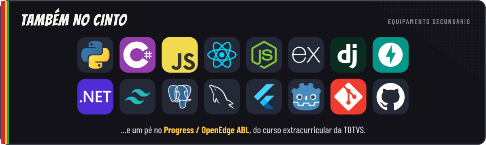
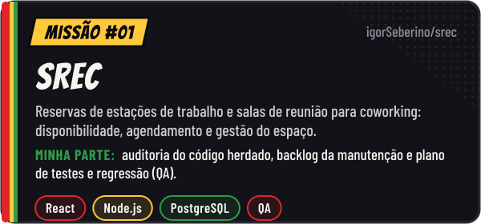
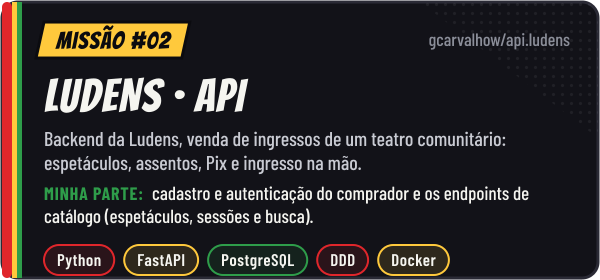
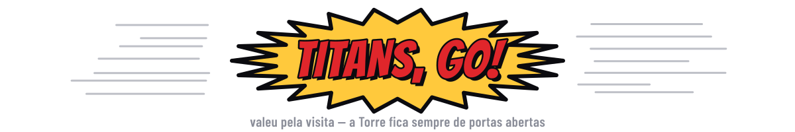

  

  

  
  
  
  

  

  

  
  

  
  

  
  

  <picture>
    <source media="(prefers-color-scheme: dark)" srcset="https://raw.githubusercontent.com/igorSeberino/igorSeberino/output/robin-snake-dark.svg">
    <source media="(prefers-color-scheme: light)" srcset="https://raw.githubusercontent.com/igorSeberino/igorSeberino/output/robin-snake-light.svg">
    
  </picture>

  

  

  
  

